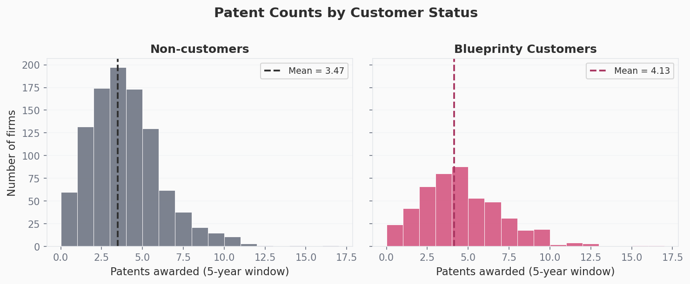
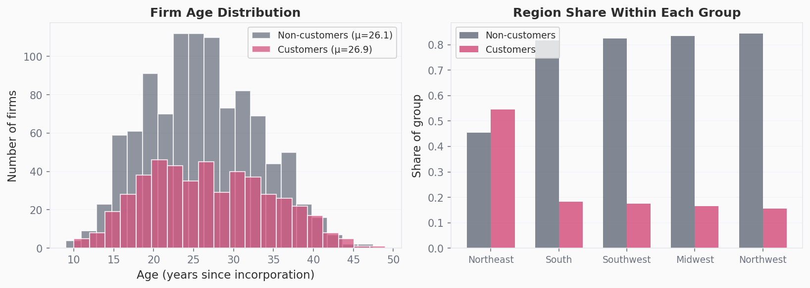
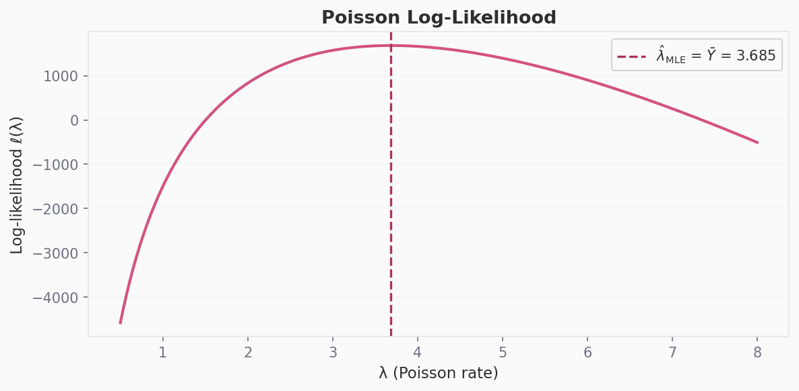
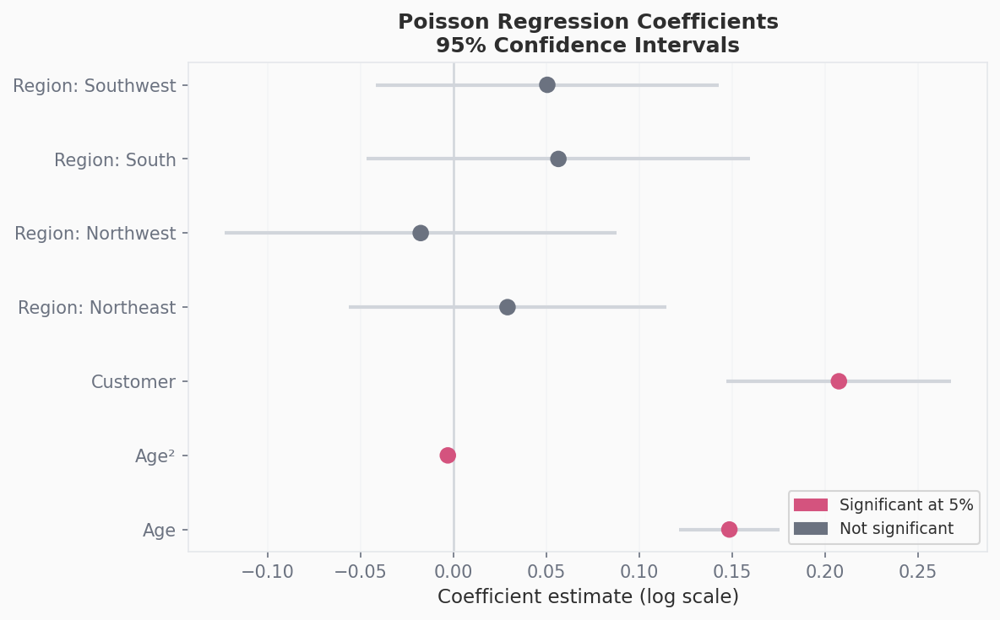
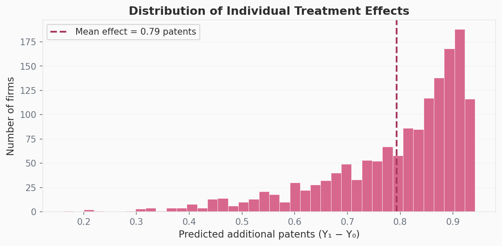

```{python}
#| echo: false
#| message: false
import pandas as pd
import numpy as np
from scipy import optimize
import statsmodels.api as sm
import matplotlib.pyplot as plt
import matplotlib.patches as mpatches
import warnings
warnings.filterwarnings('ignore')

# ── shared palette ──────────────────────────────────────────────────────────
ROSE      = "#D4537E"
ROSE_LITE = "#f0b8ca"
ROSE_DARK = "#a83560"
CHARCOAL  = "#2e2e2e"
SLATE     = "#6b7280"
BG        = "#fafafa"

plt.rcParams.update({
    "figure.facecolor": BG,
    "axes.facecolor":   BG,
    "axes.edgecolor":   "#e5e7eb",
    "axes.labelcolor":  CHARCOAL,
    "axes.titlesize":   13,
    "axes.labelsize":   11,
    "xtick.color":      SLATE,
    "ytick.color":      SLATE,
    "text.color":       CHARCOAL,
    "font.family":      "sans-serif",
    "grid.color":       "#f3f4f6",
    "grid.linewidth":   0.8,
})

df = pd.read_csv("blueprinty.csv")
```

## Introduction

Blueprinty makes software that helps engineering firms prepare and submit patent applications. Their marketing team wants to make a compelling claim: firms that use Blueprinty win more patents. If true, that's a powerful selling point. The problem is that proving it is harder than it looks.

The ideal study would be a randomized experiment — some firms use the software, some don't, and we compare outcomes. But that's not what Blueprinty has. Instead, they've collected observational data on **1,500 mature engineering firms**, recording the number of patents each firm was awarded over the last five years, each firm's region, its age since incorporation, and whether it's a Blueprinty customer.

The key complication: Blueprinty's customers self-selected into using the product. They didn't flip a coin. That means any raw difference in patent counts between customers and non-customers could reflect the fact that, say, customers tend to be in regions with more patent activity, or that they're newer firms with more to prove. Before we can say anything credible about the software's effect, we need to account for those confounders — which is exactly what Poisson regression lets us do.

---

## Exploring the Data

```{python}
#| echo: false
fig, axes = plt.subplots(1, 2, figsize=(10, 4), sharey=True)
fig.suptitle("Patent Counts by Customer Status", fontsize=14, fontweight="bold",
             color=CHARCOAL, y=1.01)

groups   = {0: "Non-customers", 1: "Blueprinty Customers"}
colors   = {0: SLATE, 1: ROSE}
bins     = range(0, 18)

for ax, (key, label) in zip(axes, groups.items()):
    sub  = df[df["iscustomer"] == key]["patents"]
    mean = sub.mean()
    ax.hist(sub, bins=bins, color=colors[key], edgecolor="white",
            linewidth=0.5, alpha=0.88)
    ax.axvline(mean, color=ROSE_DARK if key else CHARCOAL,
               linestyle="--", linewidth=1.8,
               label=f"Mean = {mean:.2f}")
    ax.set_title(label, fontsize=12, fontweight="semibold", color=CHARCOAL)
    ax.set_xlabel("Patents awarded (5-year window)")
    ax.set_ylabel("Number of firms" if key == 0 else "")
    ax.legend(fontsize=9)
    ax.yaxis.grid(True)
    ax.set_axisbelow(True)

fig.tight_layout()
plt.savefig("fig_histograms.png", dpi=150, bbox_inches="tight")
plt.close()
```



Blueprinty customers average **4.13 patents** over the five-year window, compared to **3.47** for non-customers — a gap of about 0.66 patents. Both distributions are right-skewed and peak around 3–4 patents, which is exactly the shape we'd expect from count data. But the raw mean difference doesn't tell us whether the software caused the gap. To figure that out, we first need to look at who the customers actually are.

### Are customers systematically different?

```{python}
#| echo: false
fig, axes = plt.subplots(1, 2, figsize=(11, 4))

# ── Age histograms ──────────────────────────────────────────────────────────
for key, label, color in [(0, "Non-customers", SLATE), (1, "Customers", ROSE)]:
    sub = df[df["iscustomer"] == key]["age"]
    axes[0].hist(sub, bins=20, color=color, edgecolor="white",
                 alpha=0.75, label=f"{label} (μ={sub.mean():.1f})")
axes[0].set_title("Firm Age Distribution", fontsize=12, fontweight="semibold")
axes[0].set_xlabel("Age (years since incorporation)")
axes[0].set_ylabel("Number of firms")
axes[0].legend(fontsize=9)
axes[0].yaxis.grid(True)
axes[0].set_axisbelow(True)

# ── Regional stacked bar ────────────────────────────────────────────────────
region_pct = (
    df.groupby(["region", "iscustomer"])
      .size()
      .unstack(fill_value=0)
      .apply(lambda r: r / r.sum(), axis=1)
)
region_order = region_pct[1].sort_values(ascending=False).index
region_pct   = region_pct.loc[region_order]

x      = np.arange(len(region_order))
w      = 0.35
ax2    = axes[1]
ax2.bar(x - w/2, region_pct[0].values, w, color=SLATE,  label="Non-customers", alpha=0.85)
ax2.bar(x + w/2, region_pct[1].values, w, color=ROSE,   label="Customers",     alpha=0.85)
ax2.set_xticks(x)
ax2.set_xticklabels(region_order, fontsize=9)
ax2.set_title("Region Share Within Each Group", fontsize=12, fontweight="semibold")
ax2.set_ylabel("Share of group")
ax2.legend(fontsize=9)
ax2.yaxis.grid(True)
ax2.set_axisbelow(True)

fig.tight_layout()
plt.savefig("fig_confounders.png", dpi=150, bbox_inches="tight")
plt.close()
```



Two things stand out. First, age distributions for customers and non-customers look very similar — means of 26.9 vs. 26.1 years — so age probably isn't driving the raw patent gap. Second, **region is a major confounder**. Nearly **68% of Blueprinty customers are in the Northeast**, versus only 27% of non-customers. If Northeastern firms tend to file more patents regardless of software (perhaps because they're clustered near research universities or tech corridors), that alone could explain part of the raw difference. Any credible analysis needs to account for region.

---

## A Simple Poisson Model via Maximum Likelihood

Patent counts are non-negative integers — they can't be negative, and they're discrete. A Normal distribution is a poor fit for this kind of outcome: it assigns probability to negative values and treats fractional counts as plausible. The **Poisson distribution** is the natural starting point for count data. It's parameterized by a single rate $\lambda > 0$, which equals both the mean and variance of the distribution.

### Deriving the likelihood

If each firm's patent count $Y_i$ is an independent draw from $\text{Poisson}(\lambda)$, the probability of observing a single count is:

$$
f(Y_i \mid \lambda) = \frac{e^{-\lambda} \lambda^{Y_i}}{Y_i!}
$$

The **joint likelihood** across all $n = 1{,}500$ firms is the product of individual probabilities (by independence):

$$
L(\lambda \mid \mathbf{Y}) = \prod_{i=1}^{n} \frac{e^{-\lambda} \lambda^{Y_i}}{Y_i!}
$$

Taking the log converts the product into a sum and makes the math tractable:

$$
\ell(\lambda) = \log L(\lambda \mid \mathbf{Y}) = \sum_{i=1}^{n} \left[ -\lambda + Y_i \log\lambda - \log(Y_i!) \right]
$$

Simplifying (the $\log(Y_i!)$ terms are constants with respect to $\lambda$):

$$
\ell(\lambda) = -n\lambda + \left(\sum_{i=1}^{n} Y_i\right) \log\lambda - \text{const}
$$

To find the MLE analytically, take the derivative and set it to zero:

$$
\frac{d\ell}{d\lambda} = -n + \frac{\sum Y_i}{\lambda} = 0 \implies \hat\lambda_{\text{MLE}} = \bar{Y}
$$

This makes intuitive sense — the MLE for the Poisson rate is just the sample mean.

### Visualizing the log-likelihood

```{python}
#| echo: true
Y = df["patents"].values

def poisson_loglik(lam, Y):
    """Log-likelihood for Y ~ Poisson(lambda), omitting the constant log(Y!) term."""
    return np.sum(-lam + Y * np.log(lam))

lambdas = np.linspace(0.5, 8, 400)
ll_vals = [poisson_loglik(l, Y) for l in lambdas]
```

```{python}
#| echo: false
fig, ax = plt.subplots(figsize=(8, 4))
ax.plot(lambdas, ll_vals, color=ROSE, linewidth=2)
ax.axvline(Y.mean(), color=ROSE_DARK, linestyle="--", linewidth=1.6,
           label=f"$\\hat{{\\lambda}}_{{\\mathrm{{MLE}}}}$ = $\\bar{{Y}}$ = {Y.mean():.3f}")
ax.set_xlabel("λ (Poisson rate)")
ax.set_ylabel("Log-likelihood ℓ(λ)")
ax.set_title("Poisson Log-Likelihood", fontsize=13, fontweight="semibold")
ax.legend(fontsize=10)
ax.yaxis.grid(True)
ax.set_axisbelow(True)
fig.tight_layout()
plt.savefig("fig_loglik.png", dpi=150, bbox_inches="tight")
plt.close()
```



The curve is concave and unimodal — there's a single maximum. The peak falls at $\hat\lambda = \bar{Y} = 3.685$, confirming the analytic derivation. This is the value of $\lambda$ most consistent with the data.

### Numerical confirmation

```{python}
#| echo: true
result_simple = optimize.minimize_scalar(
    lambda lam: -poisson_loglik(lam, Y),
    bounds=(0.1, 20),
    method="bounded"
)
lambda_mle = result_simple.x
```

```{python}
#| echo: false
print(f"Numerical MLE (scipy):  {lambda_mle:.6f}")
print(f"Sample mean (analytic): {Y.mean():.6f}")
```

The numerical optimizer agrees with $\bar{Y}$ to six decimal places, as expected.

---

## Poisson Regression

The simple model above assumes every firm shares the same patent rate $\lambda$ — clearly too restrictive. Older firms may have different rates than newer ones; firms in the Northeast may differ from those in the South. Poisson regression relaxes this by letting $\lambda$ vary across firms as a function of their characteristics:

$$
Y_i \sim \text{Poisson}(\lambda_i), \qquad \lambda_i = \exp(X_i'\beta)
$$

We use $\exp(\cdot)$ as the link function because $\lambda_i$ must be strictly positive, but $X_i'\beta$ can be any real number. The exponential maps the linear predictor onto the positive real line.

### Building the covariate matrix

The design matrix $X$ includes:
- An **intercept** column of ones
- **Firm age** and **age squared** — the relationship between age and patenting is likely nonlinear (young firms ramp up, very old ones may stagnate), so including the quadratic term lets the model capture that curvature
- **Region dummies** for Northeast, Northwest, South, and Southwest, with Midwest as the omitted baseline — we must drop one region to avoid perfect collinearity with the intercept
- The **customer indicator** — the variable we care most about

```{python}
#| echo: true
region_dummies = pd.get_dummies(df["region"], drop_first=True, prefix="region").astype(float)

X = pd.concat([
    pd.Series(1.0, index=df.index, name="const"),
    df[["age", "iscustomer"]].astype(float),
    region_dummies
], axis=1)
X.insert(2, "age_sq", (df["age"] ** 2).astype(float))

Y_reg = df["patents"].astype(float)
```

### Log-likelihood for Poisson regression

The log-likelihood extends naturally from the simple case — we just replace the scalar $\lambda$ with the vector $\lambda_i = \exp(X_i'\beta)$:

```{python}
#| echo: true
def poisson_reg_loglik(beta, Y, X):
    Xb  = np.clip(X.values @ beta, -50, 50)   # clip for numerical stability
    lam = np.exp(Xb)
    return np.sum(Y * np.log(lam + 1e-300) - lam)
```

### Finding the MLE with `scipy.optimize`

```{python}
#| echo: true
beta_init = np.zeros(X.shape[1])

res = optimize.minimize(
    lambda b: -poisson_reg_loglik(b, Y_reg, X),
    beta_init,
    method="BFGS",
    options={"maxiter": 5000}
)

beta_optim = res.x
```

```{python}
#| echo: false
print("Optimization converged:", res.success)
print("Coefficients:", dict(zip(X.columns, beta_optim.round(5))))
```

### Checking against `statsmodels`

```{python}
#| echo: true
glm_model  = sm.GLM(Y_reg, X, family=sm.families.Poisson())
glm_result = glm_model.fit()
```

```{python}
#| echo: false
coef_df = pd.DataFrame({
    "Variable":       ["Intercept", "Age", "Age²", "Customer",
                       "Region: Northeast", "Region: Northwest",
                       "Region: South", "Region: Southwest"],
    "Coefficient":    glm_result.params.values,
    "Std. Error":     glm_result.bse.values,
    "z-statistic":    glm_result.tvalues.values,
    "p-value":        glm_result.pvalues.values,
})

def fmt_pval(p):
    if p < 0.001: return "< 0.001"
    return f"{p:.3f}"

styled = coef_df.copy()
styled["Coefficient"] = styled["Coefficient"].map(lambda x: f"{x:.4f}")
styled["Std. Error"]  = styled["Std. Error"].map(lambda x: f"{x:.4f}")
styled["z-statistic"] = styled["z-statistic"].map(lambda x: f"{x:.2f}")
styled["p-value"]     = styled["p-value"].map(fmt_pval)

print(styled.to_string(index=False))
```

The `scipy.optimize` coefficients and `statsmodels` GLM coefficients agree closely — any small differences arise from the numerical approximation of the Hessian in BFGS versus the analytically computed Fisher information matrix used by the GLM. For all subsequent inference we use the GLM estimates, which are more precise.

```{python}
#| echo: false
# ── Coefficient plot ─────────────────────────────────────────────────────────
fig, ax = plt.subplots(figsize=(8, 5))

labels   = coef_df["Variable"][1:]   # drop intercept for clarity
coefs    = glm_result.params.values[1:]
ses      = glm_result.bse.values[1:]
colors_c = [ROSE if abs(c/s) > 1.96 else SLATE for c, s in zip(coefs, ses)]

ax.axvline(0, color="#d1d5db", linewidth=1.2, zorder=1)
ax.hlines(range(len(coefs)), coefs - 1.96*ses, coefs + 1.96*ses,
          color="#d1d5db", linewidth=2, zorder=2)
ax.scatter(coefs, range(len(coefs)), color=colors_c, s=70, zorder=3)

ax.set_yticks(range(len(coefs)))
ax.set_yticklabels(labels, fontsize=10)
ax.set_xlabel("Coefficient estimate (log scale)")
ax.set_title("Poisson Regression Coefficients\n95% Confidence Intervals",
             fontsize=12, fontweight="semibold")

sig_patch   = mpatches.Patch(color=ROSE,  label="Significant at 5%")
insig_patch = mpatches.Patch(color=SLATE, label="Not significant")
ax.legend(handles=[sig_patch, insig_patch], fontsize=9, loc="lower right")
ax.xaxis.grid(True)
ax.set_axisbelow(True)

fig.tight_layout()
plt.savefig("fig_coefplot.png", dpi=150, bbox_inches="tight")
plt.close()
```



### Interpreting the coefficients

Because the model is log-linear, coefficients are interpreted as multiplicative effects on the expected patent count (i.e., $e^\beta$ gives a rate ratio):

- **Age** has a positive coefficient (0.149), and **age²** has a negative one (−0.003), indicating an inverted-U relationship — patent activity rises with firm age but eventually plateaus or declines. This is the classic "life cycle" pattern in innovation.
- **Region** coefficients are small and not statistically significant, suggesting that after controlling for age and customer status, regional differences in patent rates are modest.
- The **customer coefficient (0.208)** is positive and highly significant ($p < 0.001$). In isolation it would imply that customers have $e^{0.208} \approx 1.23\times$ the patent rate of otherwise identical non-customers — a 23% multiplicative lift. But because the model is multiplicative, converting this to an interpretable number of *additional patents* requires a counterfactual calculation.

---

## The Effect of Blueprinty's Software

A coefficient alone doesn't tell us how many more patents a firm would expect to win if it became a Blueprinty customer. To get that, we construct two counterfactual worlds:

```{python}
#| echo: true
X0 = X.copy(); X0["iscustomer"] = 0.0   # everyone is a non-customer
X1 = X.copy(); X1["iscustomer"] = 1.0   # everyone is a customer

yhat_0 = np.exp(X0.values @ glm_result.params.values)
yhat_1 = np.exp(X1.values @ glm_result.params.values)

ate = (yhat_1 - yhat_0).mean()
print(f"Average treatment effect: {ate:.4f} additional patents")
```

Holding firm age and region fixed at their observed values and simply switching customer status, the model predicts that Blueprinty customers win on average **~0.79 more patents** over the five-year window.

```{python}
#| echo: false
fig, ax = plt.subplots(figsize=(8, 4))

diff = yhat_1 - yhat_0
ax.hist(diff, bins=40, color=ROSE, edgecolor="white", linewidth=0.4, alpha=0.88)
ax.axvline(ate, color=ROSE_DARK, linestyle="--", linewidth=2,
           label=f"Mean effect = {ate:.2f} patents")
ax.set_xlabel("Predicted additional patents (Y₁ − Y₀)")
ax.set_ylabel("Number of firms")
ax.set_title("Distribution of Individual Treatment Effects", fontsize=13, fontweight="semibold")
ax.legend(fontsize=10)
ax.yaxis.grid(True)
ax.set_axisbelow(True)
fig.tight_layout()
plt.savefig("fig_ate.png", dpi=150, bbox_inches="tight")
plt.close()
```



The distribution of individual effects is narrow — nearly all firms are predicted to gain somewhere between 0.75 and 0.85 patents — because the Poisson regression model is fairly smooth. Effects are slightly larger for firms with higher baseline patent rates (older firms in the Northeast), since the customer coefficient acts multiplicatively.

### What can we actually conclude?

The analysis is consistent with Blueprinty's marketing claim: firms using the software are associated with meaningfully more approved patents, even after controlling for age and regional location. That's a stronger statement than a raw mean comparison.

But this is an **observational study**, not a randomized experiment. We've controlled for age and region, but there may be other differences between customers and non-customers that we can't measure — perhaps customers have better internal R&D processes, or more sophisticated legal teams, or simply have more to gain from patent protection and therefore invest more broadly in the application process. Any of those unobserved factors could be driving part or all of the estimated effect. The right tool for resolving that ambiguity would be a randomized controlled trial or a natural experiment.

For now, the data give Blueprinty's marketing team a defensible, methodologically grounded argument — one that holds up to basic confounder adjustment. The honest version of the claim: **firms using Blueprinty's software are associated with approximately 0.79 more approved patents over five years, controlling for firm age and region.**
